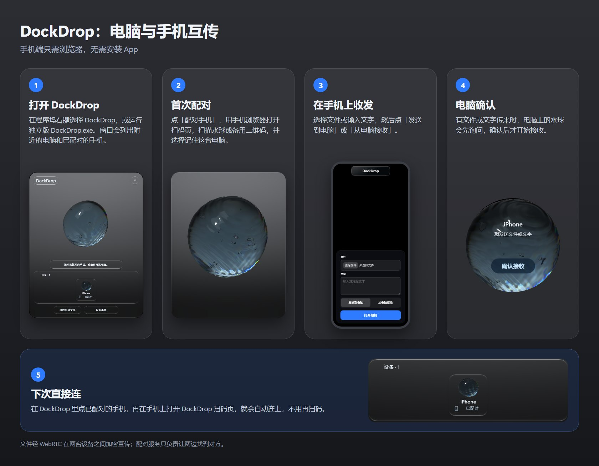
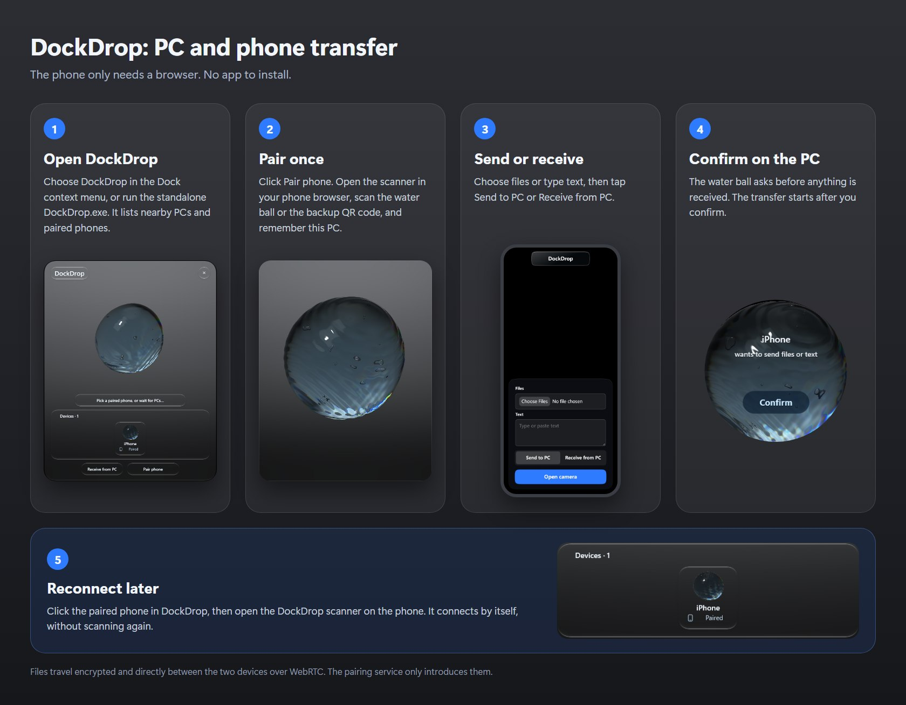
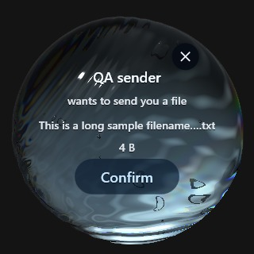
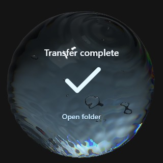
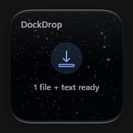

# DockDrop

[简体中文](#简体中文) · [English](#english)

## 简体中文

DockDrop 在 Windows 电脑和手机之间互传文件和文字。手机端只需要浏览器，不用安装 App。首次用手机扫描电脑上的水球或备用二维码完成配对；之后在 DockDrop 窗口里点已配对的手机，手机打开扫码页就会自动连上。电脑接收前总会先询问。

- **双向互传**：手机发给电脑，或从电脑接收文件和文字。
- **已配对手机**：窗口里列出附近的电脑和已配对的手机，点一下即可连接，最多记住 6 台手机。
- **电脑之间互传**：同一局域网里的电脑也能互相发送。
- **直连传输**：文件经 WebRTC 在两台设备之间加密直传，配对服务只负责让两边找到对方。
- **资源管理器入口**：在文件上右键即可发给已配对的手机。

### 开始使用（Windows 11 x64）

1. 从 [Releases](https://github.com/Davizcbia/DockDrop/releases/latest) 下载 `DockDrop-Windows-Portable-<版本>.zip`，解压后运行 `DockDrop.exe`。
2. 点「配对手机」，用手机浏览器打开[扫码页](https://davizcbia.github.io/dockdrop-scan/bubble/)，扫描水球或备用二维码。
3. 在手机上选择文件或输入文字，然后选「发送到电脑」或「从电脑接收」。
4. 在 DockDrop 设置里调整接收文件夹、管理已配对的手机和资源管理器入口。

手机配对需要 Microsoft Edge WebView2 Runtime（Windows 11 已自带）；电脑之间互传需要 .NET Desktop Runtime 9 或 10。界面语言跟随 Windows 或 DockOver 的语言设置。已安装 [DockOver](https://github.com/Davizcbia/DockOver) 套件时，独立版会改用套件内置的 DockDrop。

## English

DockDrop transfers files and text between a Windows PC and a phone. The phone only needs a browser, with no app to install. Pair once by scanning the water ball or the backup QR code on the PC. Later, click the paired phone in the DockDrop window and open the scanner on the phone. It connects by itself. The PC always asks before it receives anything.

- **Both directions**: send files and text from the phone to the PC, or receive them from the PC.
- **Paired phones**: the window lists nearby PCs and paired phones. Click one to connect. Up to 6 phones are remembered.
- **PC to PC**: PCs on the same network can send to each other.
- **Direct transfer**: files travel encrypted and directly between the two devices over WebRTC. The pairing service only introduces them.
- **File Explorer**: right-click a file to send it to a paired phone.

### Get started (Windows 11 x64)

1. Download `DockDrop-Windows-Portable-<version>.zip` from [Releases](https://github.com/Davizcbia/DockDrop/releases/latest), extract it, and run `DockDrop.exe`.
2. Click **Pair phone**, open the [scanner](https://davizcbia.github.io/dockdrop-scan/bubble/) in your phone browser, and scan the water ball or the backup QR code.
3. On the phone, choose files or type text, then tap **Send to PC** or **Receive from PC**.
4. In DockDrop Settings, choose the receive folder and manage paired phones and the File Explorer entry.

Phone pairing needs the Microsoft Edge WebView2 Runtime, which Windows 11 includes. PC-to-PC transfer needs .NET Desktop Runtime 9 or 10. The interface follows the Windows or DockOver language setting. When the [DockOver](https://github.com/Davizcbia/DockOver) suite is installed, the standalone app hands over to the DockDrop built into the suite.

## 功能截图 / Screenshots

| 光泡配对 / Pairing bubble | 手机文字收发 / Phone text transfer |
| --- | --- |
|  |  |
| **PC 收件请求 / PC receive request** | **实际接收进度 / Transfer progress** |
|  |  |
| **接收完成 / Transfer complete** | **DockOver 桌面暂存 / Desktop staging** |
|  |  |

[源码 / Source](https://github.com/Davizcbia/DockOver/tree/1.4.1/dockui/src/pairing) · [手机扫码页 / Phone scanner](https://davizcbia.github.io/dockdrop-scan/bubble/)
