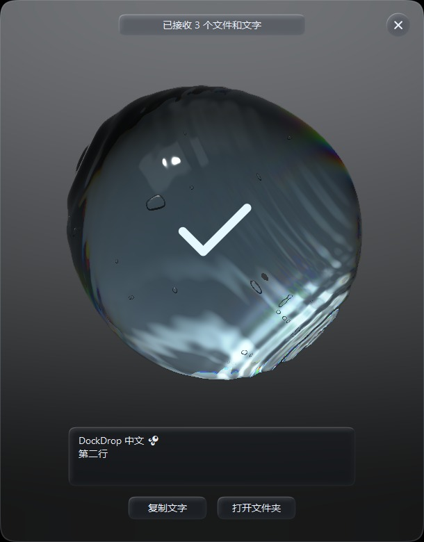

# DockDrop

DockDrop 是 DockOver 的文件和文字互传工具。Windows 端显示配对光泡和备用二维码，手机使用浏览器连接。完成首次配对后，可以记住设备并在之后重新连接。Windows 仍会在接收前显示确认。

## Windows 11 x64

1. 下载并解压 `DockDrop-Windows-Portable-0.1.0.zip`，运行 `DockDrop.exe`。
2. 用手机浏览器扫描光泡或备用二维码，在手机上选择发送或接收。
3. 在 Windows 设置窗口中调整接收目录、管理已配对手机和资源管理器入口。

电脑需要 Microsoft Edge WebView2 Runtime。简体和繁体中文由 Windows 或 DockOver 的语言设置启用。

[下载 0.1.0](https://github.com/Davizcbia/DockDrop/releases/tag/0.1.0) · [手机扫码页](https://davizcbia.github.io/dockdrop-scan/bubble/) · [共享源码](https://github.com/Davizcbia/DockOver/tree/1.1.0/dockui/src/pairing)

## 功能截图

| 光泡配对 | 手机文字收发 |
| --- | --- |
|  |  |
| **PC 收件请求** | **实际接收进度** |
|  |  |
| **接收完成** | **DockOver 桌面暂存** |
|  |  |

Release 另含同一局域网的 PC 互传预览和临时 Wi-Fi 浏览器预览。实体双机与实体手机的兼容性仍在验证中。
